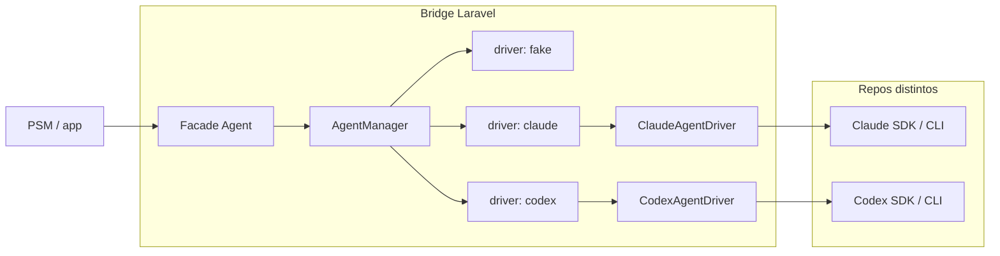
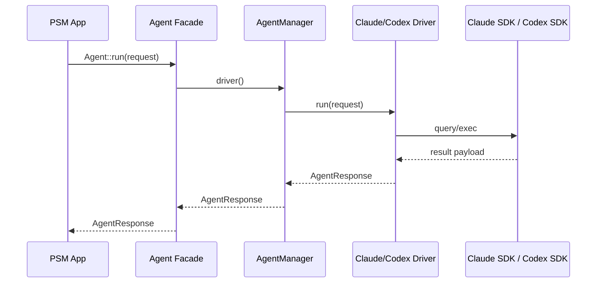
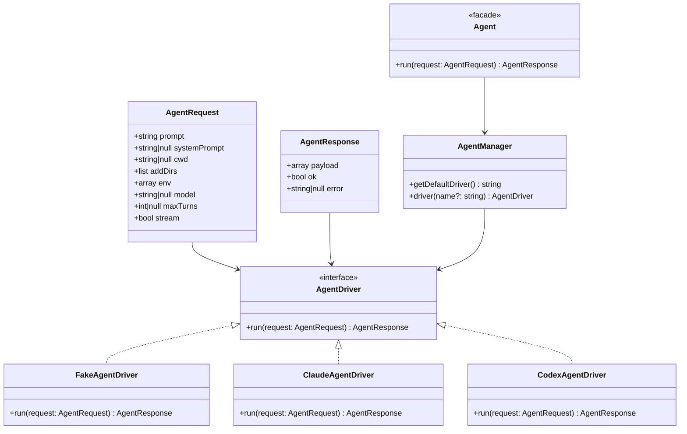

# Arquitectura del bridge multi-proveedor

## Visión general

Este paquete expone un contrato común para ejecutar agentes sin acoplar el consumo de la app a Claude ni a Codex.

La app usa una fachada (`Agent`) y un manager que resuelve el driver apropiado según la configuración.

## Diagrama de arquitectura

## Flujo de uso

## Diagrama de clases

## Principio de diseño

La app no conoce el proveedor real. Solo conoce el contrato:

- `AgentRequest`
- `AgentResponse`
- `AgentDriver`

Cada driver adapta el contrato a un SDK concreto:

- `ClaudeAgentDriver` para Claude
- `CodexAgentDriver` para Codex
- `fake` para pruebas

Esto permite cambiar de proveedor sin tocar el dominio de la aplicación.
